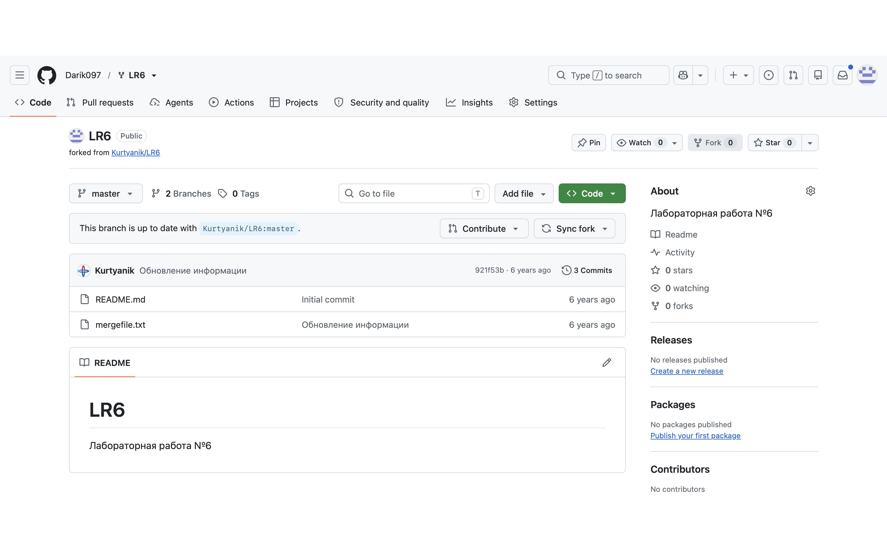
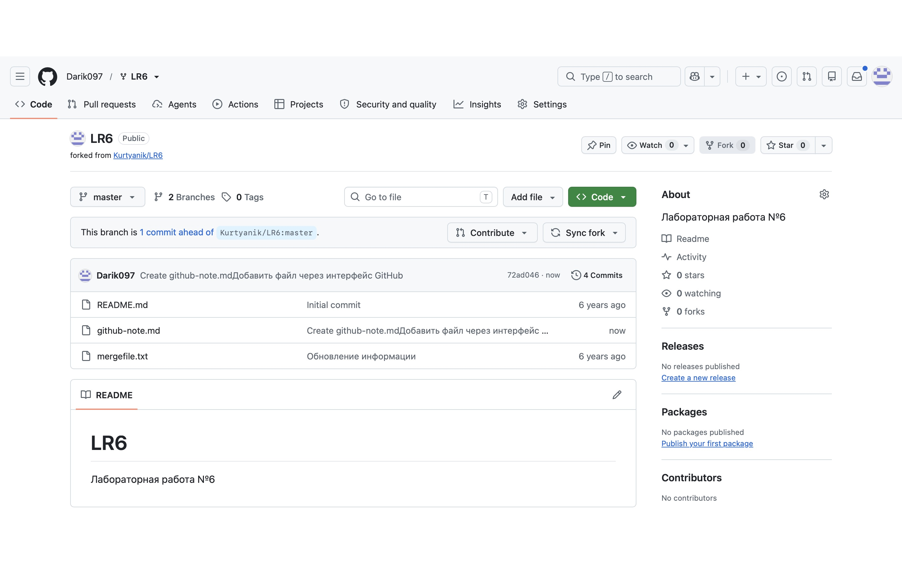
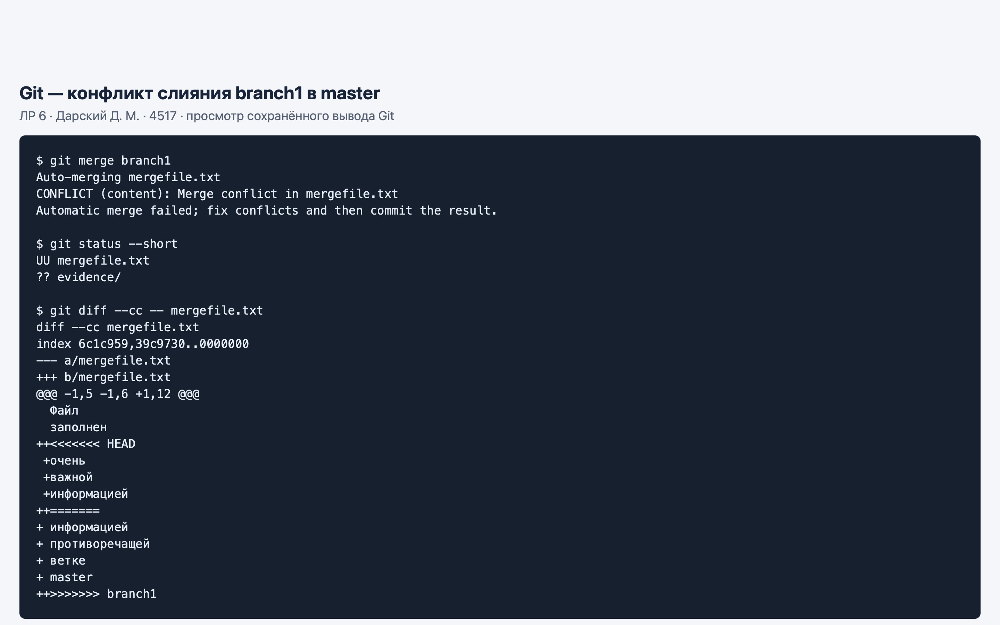
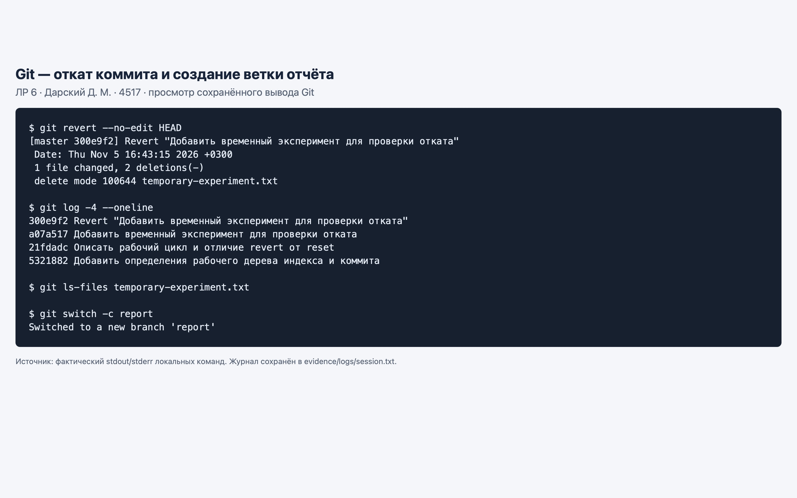
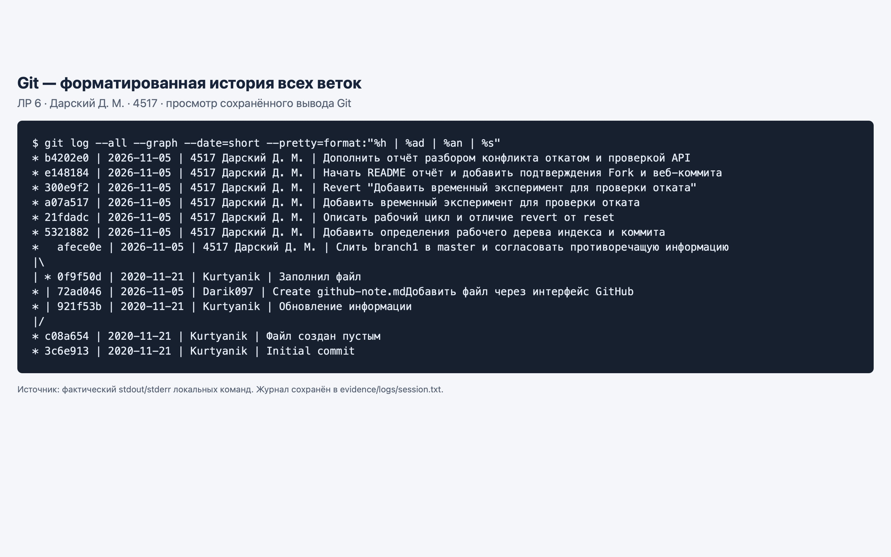

# Лабораторная работа № 6

## Система контроля версий

**Дисциплина:** Основы программирования  
**Студент:** Дарский Динар Маратович, группа 4517  
**Преподаватель:** Куртяник Д. В.  
**Вариант:** 7  
**Дата выполнения:** 5 ноября 2026 года

[Репозиторий](https://github.com/Darik097/LR6) · [Ветка отчёта](https://github.com/Darik097/LR6/tree/report)

## Цель работы

Изучить базовые возможности Git, получить опыт работы с локальным и удалённым репозиториями, историей изменений, ветками, конфликтами слияния и отменой коммитов. Проверить сведения о репозитории через GitHub REST API.

## Задание

Выполнить пункты 1–16 методических указаний: создать Fork, настроить Git, клонировать репозиторий, добавить файл через GitHub и получить его локально, изучить обе исходные ветки, разрешить конфликт при слиянии в master, удалить побочную ветку, выполнить несколько коммитов и откат, создать ветку отчёта, оформить README со снимками экрана и отдельным логом команд, включить форматированную историю и отправить изменения на GitHub.

В представленной методичке нет отдельных условий для вариантов. Номер 7 указан как идентификатор работы; выполнено общее задание ЛР 6.

## Среда и исходные данные

macOS, Git 2.50.1 (Apple Git-155), GitHub, Safari. Исходный проект: [Kurtyanik/LR6](https://github.com/Kurtyanik/LR6). В Fork сохранены исходные ветки master и branch1.

Автор локальных коммитов: `4517 Дарский Д. М.`. Для привязки коммитов к GitHub использован адрес `150348428+Darik097@users.noreply.github.com`; конфигурация задана только для этого репозитория.

## Создание Fork и синхронизация

В аккаунте Darik097 создан Fork со снятым флажком **Copy the master branch only**, чтобы скопировать branch1. Затем личный репозиторий клонирован на компьютер. Через веб-интерфейс GitHub в master добавлен файл `github-note.md`, после чего выполнено `git pull --ff-only origin master`.



Веб-коммит `72ad046` получен посредством fast-forward: локальная master перемещена с `921f53b` на `72ad046`.



## Анализ веток и разрешение конфликта

Истории изучены отдельно командами `git log master --oneline` и `git log branch1 --oneline`. Общий предок — `c08a654`; на вершине исходной master находится `921f53b`, а branch1 — `0f9f50d`. Команды `git show --stat HEAD` и `git diff master branch1 -- mergefile.txt` показывают последние изменения и расхождение содержимого.

Обе ветки изменили один участок `mergefile.txt`: в master добавлено «очень важной», в branch1 — «противоречащей ветке master». Команда `git merge branch1` завершилась ожидаемым конфликтом; `git status --short` показала `UU mergefile.txt`.



Маркеры `<<<<<<<`, `=======`, `>>>>>>>` удалены. В итоговом тексте сохранены важность информации и описание расхождения; указано, что противоречие устранено. Содержимое доступно в [mergefile.txt](mergefile.txt). После `git add mergefile.txt` создан merge-коммит `afece0e` с двумя родителями: `72ad046` и `0f9f50d`. Это подтверждает настоящее слияние двух линий истории. Локальная branch1 удалена командой `git branch -d branch1`; её коммиты остаются достижимыми из master.

Скриншоты 3–5 получены в Safari при просмотре сохранённого фактического stdout/stderr Git; это снимки просмотрщика журнала консоли. Полный текст вывода сохранён отдельно, без подмены результатов.

## Последовательные коммиты и откат

В master последовательно выполнены изменения:

| Коммит | Результат |
|---|---|
| `5321882` | Созданы определения рабочего дерева, индекса, коммита и ветки в git-notes.md |
| `21fdadc` | Дополнен рабочий цикл и объяснены fetch, pull, revert, reset |
| `a07a517` | Добавлен временный эксперимент temporary-experiment.txt |
| `300e9f2` | Командой git revert отменено добавление временного файла |

`git revert --no-edit HEAD` создала обратный коммит: экспериментальный файл исчез из отслеживаемых файлов, но исходный коммит и его отмена сохранились в истории. Откат не удаляет учебные доказательства и не переписывает опубликованную историю. Это соответствует назначению revert [2].

Затем создана отдельная ветка `report` командой `git switch -c report`. README оформлялся в ней поэтапно с промежуточными коммитами.



## Проверка GitHub API

Выполнен публичный запрос `GET https://api.github.com/repos/Darik097/LR6`. Ответ HTTP 200 подтверждает `fork: true`, родителя `Kurtyanik/LR6`, личный адрес проекта и исходную ветку по умолчанию `master`. Выборка ответа сохранена в [github-api.json](evidence/logs/github-api.json). Запрос чтения публичного репозитория не требует токена [4].

## Лог команд

[commands.txt](evidence/logs/commands.txt) содержит команды без результатов. [session.txt](evidence/logs/session.txt) — отдельный журнал с фактическим выводом, включая ожидаемый отказ автоматического слияния. Редактирование текстовых файлов выполнено между соответствующими git add и git commit.

Клонирование личной копии: `git clone https://github.com/Darik097/LR6.git`. Добавление github-note.md выполнено в веб-интерфейсе, а не локальной командой. Журнал фиксирует учебные операции; проверочные запросы API и подготовка документов приведены отдельно.

## Проверка требований задания

| Пункты | Выполнение и подтверждение |
|---|---|
| 1–2 | Аккаунт Darik097, личный Fork, рисунок 1 |
| 3–5 | Установленный Git проверен, имя и email настроены локально, личная копия клонирована |
| 6 | github-note.md создан через GitHub и получен git pull, рисунок 2 |
| 7–8 | Отдельные истории веток, просмотр коммита и diff в журнале |
| 9–10 | Конфликт устранён, merge-коммит afece0e, локальная branch1 удалена |
| 11–12 | Несколько последовательных коммитов и отмена через revert, рисунок 4 |
| 13–14 | Ветка report, README, снимки в evidence/screenshots, отдельный лог команд |
| 15 | Форматированная история приведена ниже и зафиксирована отдельным коммитом |
| 16 | Ветки master и report отправлены в личный репозиторий; окончательная проверка — совпадение локальных и удалённых хэшей |

## Выводы

Выполнен полный цикл контроля версий: Fork и clone, получение веб-коммита, изучение истории и различий, ручное разрешение конфликта, слияние веток и безопасная отмена изменения. Merge-коммит сохраняет обе исходные линии истории, а revert позволяет отменить ошибочный результат без удаления коммитов. Отчёт ведётся в отдельной ветке и содержит проверяемые хэши, журнал и снимки экрана.

## Использованные источники

1. Git — git-merge Documentation. URL: https://git-scm.com/docs/git-merge (дата обращения: 05.11.2026).
2. Git — git-revert Documentation. URL: https://git-scm.com/docs/git-revert (дата обращения: 05.11.2026).
3. ГУАП. Для учебного процесса. URL: https://guap.ru/regdocs/docs/uch (дата обращения: 05.11.2026).
4. GitHub Docs. REST API endpoints for repositories. URL: https://docs.github.com/en/rest/repos/repos#get-a-repository (дата обращения: 05.11.2026).

Разрешение конфликта выполнено по модели Git [1]. Печатная версия и титульный лист оформлены на основе официального бланка и правил ГУАП [3].

## Форматированная история

Команда: `git log --all --graph --date=short --pretty=format:"%h | %ad | %an | %s"`. Формат: сокращённый хэш, дата, автор, сообщение. Снимок истории получен после двух промежуточных фиксаций отчёта; коммит, добавляющий сам этот снимок, появляется следующим и не может содержать собственный хэш.

```text
* b4202e0 | 2026-11-05 | 4517 Дарский Д. М. | Дополнить отчёт разбором конфликта откатом и проверкой API
* e148184 | 2026-11-05 | 4517 Дарский Д. М. | Начать README отчёт и добавить подтверждения Fork и веб-коммита
* 300e9f2 | 2026-11-05 | 4517 Дарский Д. М. | Revert "Добавить временный эксперимент для проверки отката"
* a07a517 | 2026-11-05 | 4517 Дарский Д. М. | Добавить временный эксперимент для проверки отката
* 21fdadc | 2026-11-05 | 4517 Дарский Д. М. | Описать рабочий цикл и отличие revert от reset
* 5321882 | 2026-11-05 | 4517 Дарский Д. М. | Добавить определения рабочего дерева индекса и коммита
*   afece0e | 2026-11-05 | 4517 Дарский Д. М. | Слить branch1 в master и согласовать противоречащую информацию
|\  
| * 0f9f50d | 2020-11-21 | Kurtyanik | Заполнил файл
* | 72ad046 | 2026-11-05 | Darik097 | Create github-note.mdДобавить файл через интерфейс GitHub
* | 921f53b | 2020-11-21 | Kurtyanik | Обновление информации
|/  
* c08a654 | 2020-11-21 | Kurtyanik | Файл создан пустым
* 3c6e913 | 2020-11-21 | Kurtyanik | Initial commit
```



## Материалы для сдачи

[Полный отчёт PDF](deliverables/report.pdf) · [Редактируемый отчёт Word](deliverables/report.docx) · [PDF для загрузки в ЛК](deliverables/submission.pdf). В ЛК загружается PDF с титульным листом и кликабельной ссылкой на ветку report. Основной отчёт доступен по адресу https://github.com/Darik097/LR6/tree/report.
